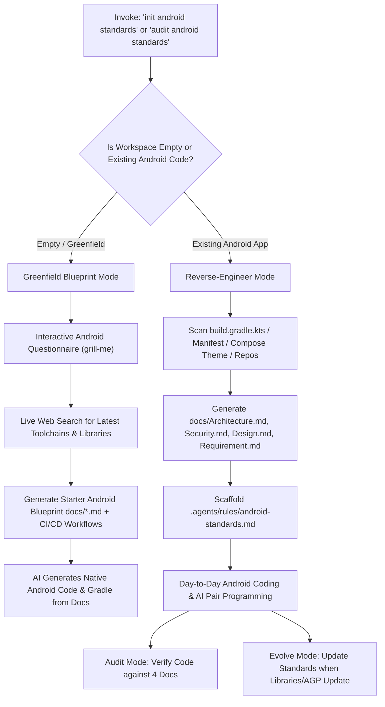

# Android Standards Engine (`android-standards`)

The **Android Standards Engine** establishes a four-pillar documentation foundation (`Architecture.md`, `Security.md`, `Design.md`, `Requirement.md`) dedicated to **Native Android development** (Kotlin, Jetpack Compose, Material 3, Coroutines/Flow, Room, Hilt, and OWASP MASVS Mobile Security).

It acts as the executable specification for AI agents and Android developers—allowing new projects to be generated from scratch without cloning heavy template repositories, while enforcing strict production readiness, security compliance, and UI consistency on existing Android apps.

> [!NOTE]
> This skill is specifically tailored for **Native Android**. Separate specialized skills exist for other platforms (e.g., iOS SwiftUI, Flutter).

---

## The Four Android Foundations

| Document | Purpose | Core Contents |
| :--- | :--- | :--- |
| **`Architecture.md`** | Native Android Architecture | Real-time latest stable toolchain from web search (AGP, Gradle distribution, Kotlin, Compose BOM, Navigation 3 / Navigation Compose, Hilt DI, Retrofit/OkHttp, Room DB, DataStore), Concurrency (`viewModelScope`, zero `runBlocking`), modularization roadmap, pluggable analytics, and CI/CD pipelines. |
| **`Security.md`** | Android App Security & MASVS | OWASP MASVS, Network Security Config (`network_security_config.xml`), OkHttp Certificate Pinning, Android KeyStore AES-256-GCM, BiometricPrompt, R8/Proguard rules, root & integrity defense, analytics PII redaction. |
| **`Design.md`** | Compose Material 3 & Accessibility | Plus Jakarta Sans typography, ColorScheme tokens, standard 10px corner radiuses (`RoundedCornerShape(10.dp)`), Google Play Store & WCAG2Mobile accessibility guidelines (48dp touch targets, 4.5:1 / 3:1 contrast, 200% dynamic font scaling, TalkBack semantics, live regions). |
| **`Requirement.md`** | Android Business & Domain Spec | App mission, target user personas, offline Room caching, speech/voice services, FCM notifications, pluggable telemetry requirements, Gherkin acceptance criteria. |

---

## Workflows & Capabilities

---

## 1. Greenfield Mode (New / Empty Android Project)

When starting a fresh Android project without an existing template repository:
> **Core Principle**: Replace the boilerplate starter repo. The AI agent uses the 4 generated markdown files as the specification to write 100% of the native Android code.

### Execution Steps
1. **Detect Workspace**: Check file count. If workspace is empty or contains only `README.md` / `.git` / design docs:
2. **Conduct Interactive Android Interview** (Ask one question at a time using `ask_question`):
   - **Branch 1: Architecture & Navigation**: Jetpack Compose + Navigation 3 vs Navigation Component; MVVM vs MVI; Single-module vs Multi-module target.
   - **Branch 2: Dependency Injection & Persistence**: Dagger Hilt vs Koin; Room Database with KSP vs SQLDelight; Jetpack DataStore preferences vs Proto.
   - **Branch 3: Security & Network**: Target MASVS level (L1 / L2 / L2+R); Certificate Pinning domain; Android KeyStore AES-GCM encryption requirements; Proguard / R8 level.
   - **Branch 4: Compose Design Tokens**: Primary brand color, font family (e.g. Plus Jakarta Sans, Inter, Roboto), button corner radius (e.g. 10px vs pill), light & dark mode policy.
   - **Branch 5: Domain & Features**: Core user personas, primary flows (Auth, Feed, Chat, Settings), offline caching requirements.
   - **Branch 6: CI/CD Platform**: Bitbucket Pipelines, GitHub Actions, GitLab CI, or Fastlane.
   - **Branch 7: Pluggable Analytics**: Firebase Analytics (Default), PostHog, Mixpanel, New Relic, or Custom local logging.
3. **Pre-Flight Live Web Search for Latest Libraries & Toolchains (MANDATORY)**:
   - **Never rely on training-cutoff static versions** (e.g., AGP 8.x, Gradle 8.x, Kotlin 2.0.x). Android toolchains evolve rapidly.
   - Execute real-time web searches (`search_web`) against Maven Central, Google Android Developers release pages (`developer.android.com/jetpack/androidx/releases`), and Gradle distributions (`services.gradle.org/distributions`):
     - **AGP & Gradle:** Query `site:developer.android.com/build/releases/gradle-plugin` and `services.gradle.org/distributions gradle` for latest stable AGP (e.g. 9.5+) and matching Gradle wrapper (e.g. 9.8+).
     - **Kotlin & KSP:** Query latest stable Kotlin (e.g. 2.4+) and matching KSP plugin.
     - **Compose & UI:** Query latest `androidx.compose:compose-bom`, `androidx.activity:activity-compose`, and `androidx.navigation:navigation-compose`.
     - **Core & Lifecycle:** Query latest `androidx.core:core-ktx` and `androidx.lifecycle:lifecycle-runtime-ktx` / `lifecycle-runtime-compose`.
     - **Architecture & DI:** Query latest `com.google.dagger:hilt-android` and `androidx.room:room-runtime`.
     - **Network & IO:** Query latest `com.squareup.okhttp3:okhttp`, `com.squareup.retrofit2:retrofit`, and `org.jetbrains.kotlinx:kotlinx-coroutines-android`.
   - Ensure `build.gradle.kts` uses modern Kotlin compiler DSL (`compilerOptions { jvmTarget.set(JvmTarget.JVM_17) }`) instead of deprecated `kotlinOptions`.
4. **Scaffold Foundation Documents & CI/CD Workflows**:
   - Write `docs/Architecture.md` with package structure, real-time resolved toolchain versions, pluggable analytics, and Android coding rules.
   - Write `docs/Security.md` with encryption and secret protection rules.
   - Write `docs/Design.md` with Compose design tokens, accessibility, and component specs.
   - Write `docs/Requirement.md` with user stories, analytics telemetry, and Gherkin acceptance criteria.
   - Generate CI/CD workflow based on user choice:
     - Bitbucket: `bitbucket-pipelines.yml` + setup checklist.
     - GitHub Actions: `.github/workflows/android.yml` (configured with JDK matching the latest Gradle requirements).
     - GitLab CI: `.gitlab-ci.yml`.
     - Fastlane: `fastlane/Fastfile`.
5. **Scaffold Active Agent Rule**:
   - Create `.agents/rules/android-standards.md` so all future AI conversations automatically reference these documents.
6. **Prompt to Generate Codebase**:
   - Offer to generate: `build.gradle.kts` (with Version Catalog `libs.versions.toml` populated with the live web-searched latest library versions), `AndroidManifest.xml`, `Theme.kt`, `MainActivity.kt`, and the initial screen composables directly from the 4 markdown specs!

---

## 2. Reverse-Engineer Mode (Existing Android Codebase)

When run on an existing native Android repository:

### Execution Steps
1. **Analyze Codebase**:
   - Parse Gradle configuration: AGP version, `compileSdk`, `minSdk`, dependencies from `libs.versions.toml` or `build.gradle.kts`.
   - Inspect presentation layer: Jetpack Compose version, ViewModel state management (`StateFlow<UiState>`), navigation framework.
   - Detect DI setup: Dagger Hilt (`@HiltAndroidApp`, `@AndroidEntryPoint`, modules).
   - Review network & persistence: Retrofit, OkHttp interceptors, Room DAOs, DataStore.
   - Inspect security configurations: `network_security_config.xml`, Proguard rules, native C++ (`CMakeLists.txt`), keystores.
   - Inspect theme: `ui/theme/` (Color, Theme, Typography, Shapes).
   - Detect CI/CD: Existing `bitbucket-pipelines.yml`, `.github/workflows/`, or Fastlane files.
   - Detect telemetry: Check analytics helpers (Firebase, New Relic, local loggers).
   - Extract domain concepts: Screens, repositories, data models.
2. **Synthesize Dual-Specification Docs**:
   - Document both the **Current Implementation Baseline** and **Target Golden Standards** in:
     - `docs/Architecture.md`
     - `docs/Security.md`
     - `docs/Design.md`
     - `docs/Requirement.md`
3. **Install Workspace Agent Rule**:
   - Ensure `.agents/rules/android-standards.md` exists and points every agent turn to the 4 files.

---

## 3. Audit & Enforcement Workflow

Run `android-standards audit` whenever reviewing Android code, PRs, or before release builds:

### Automated Inspection Checklist
1. **Architecture & Concurrency Check**:
   - Are ViewModels exposing immutable `StateFlow<UiState>` and one-off `Channel<UiEffect>`?
   - Is there any thread-blocking (`runBlocking`, disk/network I/O on UI thread or OkHttp interceptors)?
   - Are Compose screens split into Stateful routes and Stateless screens?
   - Are Navigation 3 keys deterministic (no random UUIDs in constructors) with predictive back support?
   - Are edge-to-edge window insets applied (`statusBarsPadding()`, `navigationBarsPadding()`, `imePadding()`)?
   - Are background sync operations routed through `WorkManager` with exponential backoff?
   - Are reactive flows tested using CashApp Turbine and Coroutines Test?
   - **Pluggable Analytics Check**: Is telemetry dispatched strictly via `AnalyticsTracker` with type-safe `AnalyticsEvent`? (No direct `FirebaseAnalytics` imports in UI/ViewModel).
2. **Security & Google Play Compliance (OWASP MASVS)**:
   - Any hardcoded API keys, tokens, or plaintext secrets in Kotlin or C++ files?
   - Is cleartext traffic prohibited (`cleartextTrafficPermitted="false"`)?
   - Are sensitive headers (`Authorization`, `x-client-secret`) sanitized before logging?
   - Are native C++ shared libraries compiled with 16 KB memory page size alignment (`-Wl,-z,max-page-size=16384`)?
   - Is microphone recording preceded by a prominent in-context disclosure?
   - Is there a verified in-app and web account deletion mechanism?
   - Are analytics parameters sanitized to exclude PII (emails, names) and PHI (medical diagnosis)?
   - Do Android components have explicit `android:exported="false"` declarations?
   - Are release builds configured with `isMinifyEnabled = true` and `isShrinkResources = true`?
3. **Design System & Accessibility Check (Google Play & WCAG2Mobile)**:
   - Are hardcoded hex colors (`Color(0xFF...)`) avoided in favor of `MaterialTheme.colorScheme`?
   - Do buttons and inputs adhere to the standard `10px` corner radius?
   - Are all displayed UI strings externalized in `strings.xml` via `stringResource(R.string.*)` (zero hardcoded strings)?
   - Is RTL layout direction respected using `Start` / `End` instead of `Left` / `Right`?
   - Do all interactive elements meet the `48.dp` x `48.dp` minimum touch target size (`Modifier.minimumInteractiveComponentSize()`) with 8dp spacing?
   - Do contrast ratios satisfy WCAG AA/AAA (≥ 4.5:1 for normal text, ≥ 3.0:1 for large text and graphical components)?
   - Can text cleanly scale up to 200% font size without container clipping (no fixed height text containers)?
   - Do interactive icons provide meaningful, localized `contentDescription` for TalkBack?
   - Do complex card components merge child semantics using `semantics(mergeDescendants = true)`?
   - Do dynamic chat and speech-to-text streams declare `liveRegion = LiveRegionMode.Polite`?
4. **Requirement & Offline Sync Alignment**:
   - Does the added feature map to a requirement in `docs/Requirement.md`?
   - Are offline fallbacks (Room cache) and optimistic updates handled?
   - Are concurrent edits resolved via UTC timestamps and Last-Write-Wins (LWW)?

---

## 4. Evolution Workflow (Updating Android Standards)

When upgrading Android dependencies or patterns (e.g. migrating to Navigation 3, adopting KMP modules, or updating AGP):
1. **Live Web Search Check:** Always run live web searches (`search_web`) against Maven Central, Google Android Developers release pages, and Gradle distributions to confirm the exact latest stable versions.
2. Update the appropriate file in `docs/` (`Architecture.md`, `Security.md`, `Design.md`, or `Requirement.md`).
3. Add an entry to the document's Revision History.
4. Synchronize any updated constraints into `.agents/rules/android-standards.md` and `gradle/libs.versions.toml`.
5. Run regression checks to verify ongoing compliance.
